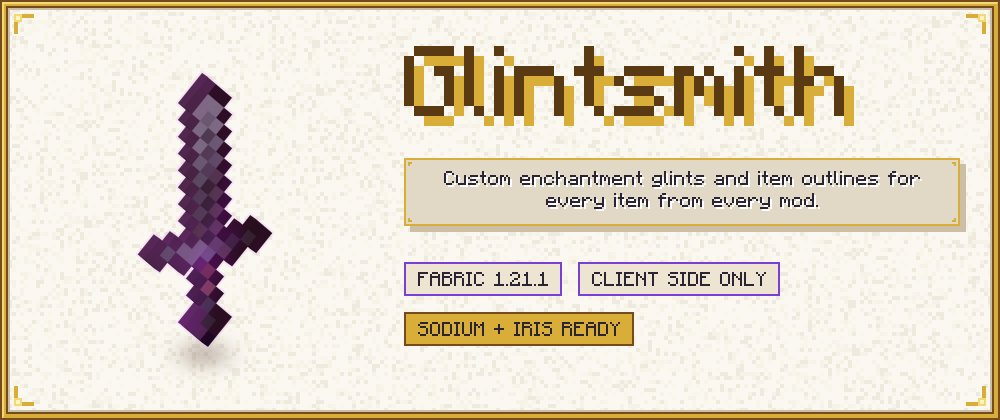

# Glintsmith



Glintsmith is a client-side Fabric mod for Minecraft 1.21.1 (mod id `glintsmith`). It draws outlines around items,
replaces the enchantment glint with textures and colours of your choice, and closes the thin gaps the game leaves in
flat item models. All three work for every item of every mod. There are no item whitelists and no resource-pack
overrides per item: what an item looks like on screen is what the mod works from.

Everything is set up in one in-game screen (English and German), which shows a live preview of the item in your hand
with the settings you are changing. The same settings live in one JSON file that is reloaded while the game runs.

## Features

### Item outlines

- The outline is computed from what the game really draws: the item's geometry is copied into a screen-space mask and an
  exact distance transform turns it into an outline. Flat items, 3D models and items of other mods are treated the same
  way. Checked in game on the vanilla netherite sword, trident and shield, and on items of advancednetherite,
  eternal_starlight, cataclysm and immersive_armors (an ingot, a morning star, a targe and a worn chestplate).
- The outline is depth aware: it is hidden where a wall or another block is in front of the item. Checked in game: no
  outline through a pillar, and dropped items and item frames behind blocks have none. In first person the arm hides the
  outline without a shader pack. Held items of other players were not tested.
- Where outlines are drawn: first-person hand, third-person held items (players and mobs), dropped items, item frames,
  worn armor (this includes worn elytra) and items in the GUI (inventory, hotbar, menus) are on by default. Other places
  such as items worn on the head are available and off by default. Each place has its own switch.
- Which items get one: enchanted items (this includes items that only show the vanilla glint), all items, or only the
  items your rules select.
- Look: thickness (0.5 to 16 screen pixels, optionally per place), softness, opacity, distance fade (0 to 256 blocks)
  and proportional width (see below). "Only my items" limits outlines to what you hold or wear.
- Thickness per place: Outline tab > "Thickness per place" gives first person, third person, armor, dropped items, item
  frames, the GUI and other places an optional thickness of their own (config: `outline.targetThickness`). A place
  without one uses the global thickness, and a rule that sets a thickness still wins.
- Proportional width (Outline tab, "Proportional", on by default, `outline.proportional`): the thickness is measured on
  the item held in first person at a window height of 1080 pixels. Every other item (inventory icons, third-person and
  dropped items, item frames, worn armor, the settings preview) gets an outline in proportion to its size on screen, so
  far items get thinner bands and inventory icons a thin line instead of a thick glow. "Minimum width"
  (`outline.minThickness`, default 1 px at a window height of 1080, scaled with the window height, never wider than the
  look's own width) keeps small and far items outlined. With Proportional off, a thickness has the same width in screen
  pixels in every place, the GUI included (the GUI scale does not change it), and "Scale with window size"
  (`outline.scaleWithResolution`) optionally scales that width with the window height, measured at 1080 px. That option
  has no effect while Proportional is on, because proportional widths follow the window size by themselves. Checked in
  game (8.5 px on the held item, a thin line in the inventory, thinner bands on distant dropped items).
- Colours: static, rainbow, pulse, gradient (up to 16 colours) or enchantment colours, where the outline fades through
  the colours of the enchantments on the item. Every vanilla enchantment has a built-in colour, every other enchantment
  gets a stable colour of its own, and you can change any of them.
- Low-durability alert: the outline pulses towards an alert colour when the remaining durability is at or below a
  threshold (default 10 %, `#FF2A2A`).

### Enchantment glint

- Four layers, each with its own settings and its own on/off switch: items (hand, dropped, frames), armor, entities, GUI.
- Texture: the vanilla glint, one of the generated presets (`preset:rainbow`, `aurora`, `fire`, `frost`, `sparkle`,
  `gold`, `void`, and the more detailed `inferno`, `nebula`, `starlight`, `opal`, `storm`; plus `neutral`, a grey
  version of the vanilla glint that is meant for tinting), your own PNG (`file:<name>.png`), or a texture from a
  resource pack (`namespace:path`). The first seven are soft diagonal streaks like the vanilla glint over an even glow
  in each preset's colours; the detailed ones are rising flame tongues (inferno), swirling clouds with stars (nebula),
  four-pointed sparkles (starlight), iridescent flashes (opal) and branching lightning (storm). The presets are generated
  by the mod's own code at start-up; no third-party art is included. All twelve presets and `neutral` with a tint were
  checked in game on the item layer in first person, and the fire preset on armor.
- Tint (any colour mode, including per-enchantment), speed, scale, strength and rotation.
- The glint keeps following the game's own Glint Speed and Glint Strength sliders; the mod's values are multiplied onto them.
- A master switch ("Custom glint" on the Glint tab, `glint.enabled`) turns the whole feature off and leaves the vanilla
  glint untouched. Each layer also has its own switch, and its texture can be set back to `vanilla`.
- Atlas-independent scale (Glint tab, on by default): item glints are textured through the item's own UVs on the block
  atlas, like vanilla. In packs with a very large block atlas (for example 8192 x 4096 px) an item covers only a tiny
  part of the atlas, so a preset at Scale 1.00 would look like a flat colour wash instead of its bands or sparkles. The
  mod reads the size of the block atlas after every resource reload and corrects the scale of customised item glints, so
  Scale 1.00 looks like vanilla density in any pack. It applies to items in hand, on the ground, in item frames and in
  the GUI. Armor, elytra and entity models use their own textures and are not changed, and high-resolution resource
  packs are not affected. Glints you did not customise stay exactly vanilla (a fresh config customises all four layers,
  see "Built-in defaults" below). If you lowered Scale for a large atlas in
  1.0.0 (to about 0.13), set it back to 1.00, because the correction and the manual value would multiply. Switch the
  option off to get the 1.0.0 behaviour. Checked in game in a pack with an 8192 x 4096 px block atlas: with the option
  on, Scale 1.00 shows the preset pattern at vanilla density on held items; with it off, the flat wash of 1.0.0.

### Model gap fix

- Closes the hairline gaps between the faces of flat generated item models (Mojang bug MC-73186). It is a clean-room
  implementation of the general technique (see Credits): the UV shrink the game applies on the block atlas can be
  scaled, the side faces of generated items can be grown and moved inwards, and optionally the side faces are built from
  contiguous pixel runs only.
- Modes: off, automatic (values chosen by the mod: it slightly widens the side faces to close the 1 px corner cracks of
  generated item models, and macOS gets its own values because its drivers bleed without UV shrink) or custom (your values). With "precise spans" the sides are built from more, smaller faces, which is exact but creates
  many more quads on HD textures; it is off by default. In game, automatic mode closed the step-corner cracks without
  slivers.
- Edge guard (since 2.0.1, always on while the gap fix is on): the front and back faces of a flat item stop 1/64 of a
  texture pixel short of the texture's border, and the side faces never sample on a texel border across the item's
  thickness. Without the game's UV shrink, a pixel at the item's edge could otherwise take the colour of the
  neighbouring texture on the block atlas (a single stray pixel, which the outline then rings). The texture stays exactly
  aligned with the side faces, so the guard reopens none of the cracks, and it works the same on atlases of any size.
- Automatic mode switches itself off when the mod `modelfix` (Model Gap Fix) is installed, because that mod already closes
  the seams. Custom mode still applies next to it, on top of that mod's own changes; precise spans do nothing then.
- If the fix throws an error while a model is generated, it logs it once and stays off for the session.

### Rules

Rules say which items get which look. They are evaluated in order, and later rules override earlier ones, so a "deny" is a
rule with the outline switched off, placed after the broader rule.

A rule can match by:

- item id (`minecraft:diamond_sword`), tag (`#minecraft:swords`), mod (`@cataclysm`), wildcard (`*_sword`, `mymod:*`) or negation (`!pattern`), several per box, separated by commas
- an exception list of the same patterns ("Except")
- enchantments (any of the listed ones), whether the item is enchanted, and the places it is drawn in

A matching rule can override the outline (on/off, colour, thickness, softness, opacity) and the glint (on/off, texture,
tint, speed, scale, strength, rotation). Everything it leaves on "inherit" is taken from the global settings or from earlier
rules. A rule with an invalid pattern does nothing, stays in the file so you can fix it, and the screen says why it is invalid.

A fresh config contains two example rules: a pale yellow outline for the Totem of Undying, and no outline on enchanted books.

### Configuration

- Own settings screen built from vanilla widgets, with tabs Outline, Glint, Model fix, Rules and Enchantments, a colour
  picker and tooltips on every setting. English and German.
- Live preview: a framed panel right of the options shows the item in your main hand as it looks in first person
  (outline and glint), with the settings on screen before you save them. Unsaved edits in the rule editor, the colour
  style screen and the colour picker show up in it too. The item turns slowly by itself; drag to turn it, right click to
  reset the view. A strip under the panel switches between the held item and a sample enchanted netherite sword (a
  plain glinting sword when no world is loaded). Notes under the item say why something is not shown: outlines off, no
  outline for this item, a map in the hand, a shader pack, an empty hand, a rule that does not match. In narrow windows
  the panel moves next to the footer buttons of the main screen; if there is no room at all it is hidden. The model gap
  fix is not part of the preview, because it only changes after a resource reload. Under a shader pack the preview
  shows the configured look and a note says what the pack changes in your hand. If drawing the preview ever fails, only
  the preview switches itself off. Checked in game with the held enchanted item on the Outline and Glint tabs: the
  panel sits right of the options, the item, its outline and its glint are animated and follow the unsaved settings.
  Dragging, right click reset, the source strip, narrow windows and the shader note have not been tried by hand.
- Built-in defaults: a fresh config (no `glintsmith.json` yet) and "Reset tab" use these. Outline: on in every place
  except "other" (so on worn armor and in the GUI too), a static light purple colour (#E6B2FF), thickness 7.5 px,
  opacity 25 %. Glint: all four layers (items, armor, entities, GUI) use the neutral preset with a light purple rainbow
  tint (#D088FC, speed 1.0, strength 90 %). Existing config files keep their values. The "Reset tab" button (with a
  confirmation; saved only when you press Done) puts the tab back to these values, not to the vanilla look. To get the
  vanilla glint back, turn off "Custom glint" on the Glint tab, or set the texture of a layer to `vanilla`; to remove
  all outlines, turn off "Outlines" on the Outline tab.
- Opens from the Mod Menu entry (Mod Menu is optional), with `/glintsmith`, or with a key (see below).
- `config/glintsmith.json` is read again about once a second when it changes on disk, and with `/glintsmith reload`. A file
  that cannot be parsed is ignored: the previous settings stay and the problem is logged and shown.
- Settings that are out of range are clamped, settings that are invalid are reset, and the repaired values are listed
  in the log and by `/glintsmith reload`.
- Your own glint textures go to `config/glintsmith/glints/`. The screen has a button that opens the folder.

## Commands and keys

| What | Effect |
|---|---|
| `/glintsmith` | Opens the settings screen |
| `/glintsmith reload` | Reads `glintsmith.json` again and lists repairs |
| `/glintsmith toggle` | Switches all outlines on or off and shows a short message on the action bar |
| Key "Open Glintsmith settings" | Opens the screen; category Glintsmith, unbound by default |
| Key "Toggle item outlines" | Same as `/glintsmith toggle`; unbound by default |

The commands are client commands: they need no operator permission and are not sent to a server.

## Install

1. Install Fabric Loader and Minecraft 1.21.1.
2. Put [Fabric API](https://modrinth.com/mod/fabric-api) and the Glintsmith jar into the `mods` folder.
3. Optional: Mod Menu for the config button, Sodium, Iris.

Client side only. Do not put it on a server; the mod does nothing there and is declared client-only.

| | Version |
|---|---|
| Minecraft | 1.21.1 |
| Fabric Loader | 0.16.0 or newer in `fabric.mod.json`; developed and run with 0.19.5 |
| Java | 21 |
| Fabric API | required (developed with 0.116.17+1.21.1) |
| Mod Menu | optional (11.0.5 was used) |
| Sodium | optional, supported (0.8.13 was used) |
| Iris | optional, supported (1.8.14-beta.1 was used) |
| ImmediatelyFast | optional, HUD batching and custom glints supported (1.6.15 was used) |

## Compatibility

- **Sodium.** Supported. Works with Sodium 0.8.13 in the test pack. The log has one expected Sodium WARN that
  `TeeVertexConsumer` does not support optimized vertex writing; it is harmless.
- **ImmediatelyFast.** HUD batching works with GUI outlines. An outlined GUI item flushes the batch before its outline
  is drawn, so the hotbar sprite, the items and the counts are drawn and outlined as usual. Checked in game with
  ImmediatelyFast 1.6.15. Custom glints are also applied to its buffers (first-person hand, world without Iris,
  inventories, menus and the batched hotbar); the inventory and the hotbar were checked in game too. Without
  ImmediatelyFast nothing changes.
- **First-person animation mods (Punchy).** The held item keeps its first-person outline and glint rules (checked in
  game with Punchy 2.8f, main hand and offhand). Items such as
  Punchy's bedrock-geometry items, chests and boats are not outlined in first person, and with player-animation-lib or
  Better Combat in first-person mode the held item is outlined as a third-person item (none under a shader pack).
- **Iris with no shader pack selected.** Treated like vanilla rendering. Custom glints work everywhere, including in the
  world (armor, held items of other entities, item frames, dropped items). Checked in game with Iris 1.8.14-beta.1: the
  generated presets show in their colours on armor stands, against the purple vanilla glint.
- **Iris with a shader pack.** World outlines (third person, armor, dropped items, item frames) are turned off, because
  the scene depth they need is not available. Hand outlines stay on by default ("Hand with shader pack" switches them
  off), and the arm hides them correctly. GUI outlines work. "Off with shader packs" disables all outlines while a pack
  is active. The glint keeps the vanilla look in the world and in the hand under a shader pack and is customised in the
  GUI. Checked in game with Iris 1.8.14-beta.1 and Complementary Unbound with Euphoria Patches: no crash, one INFO line
  in the log ("A shader pack is active: world outlines are off, first-person and GUI outlines stay on."), world outlines
  off, hand outlines on with the arm hiding them (no outline along the sleeve), GUI outlines (inventory, hotbar) work,
  and the settings screen shows a hint about shader packs.
- **Fabulous graphics.** Tested in game without a shader pack: held items, item frames, dropped items, occlusion,
  stained glass (from the front and the side), water, rain and GUI outlines are all correct.
- **Other glint mods.** A mod that replaces the vanilla glint render types itself can win over Glintsmith's glint, or the
  other way round. Use one of them.
- **Items drawn without the game's normal item rendering** are not outlined. This means items that never go through
  `ItemRenderer.render`, for example some items that a mod draws with its own code. Mods that only batch the drawing of
  GUI items, like ImmediatelyFast, are not affected.
- **Model Gap Fix (`modelfix`).** Compatible. Only the precise spans part of the gap fix is left out while it is installed,
  because that mod replaces the same game method; the other parts of the gap fix work as usual. In automatic mode the gap fix
  stays off, and `modelfix` handles the seams. In custom mode the settings of Glintsmith stack on top of `modelfix` (logged
  once at INFO), and precise spans are inactive. This is covered by unit tests; it has not been tested in game,
  because `modelfix` was not in the test pack.
- **Failure behaviour.** Outlines, glint and gap fix each have a failsafe: after an error in a render hook the feature
  logs it once and stays off for the session; the game keeps rendering the vanilla way.
- **Cost.** Frames in which no outlined item is drawn do no outline work except the rule lookup per drawn item. One
  measurement, on one test scene and one machine (Nytheria pack, no shader pack): three identical windows without the
  mod gave 656, 470 and 531 fps, and with the mod 496, 643 and 587 fps. The cost of the outlines is within the
  run-to-run noise of that scene. This says nothing about other scenes or machines.

## Compared with other mods and packs

A table with the details and the sources is on the CurseForge page text in [docs/curseforge/description.md](docs/curseforge/description.md).
In short: Custom Glow Enchantment Outline draws outlines on held items, Model Gap Fix removes texture zooming, the Rainbow
Enchantment Glint and Enchantment Outlines resource packs swap fixed looks. Glintsmith puts the three jobs in one mod,
for all items, with rules and one config. It supports only Fabric on Minecraft 1.21.1, where those projects reach more versions and loaders.

## Building

Needs Java 21. The Gradle wrapper downloads everything else.

```
./gradlew build          # Windows: gradlew.bat build
./gradlew test           # unit tests only
```

The mod jar is `build/libs/glintsmith-2.0.2.jar`. Stack: Fabric Loom, official Mojang mappings, Java 21. Sodium, Mod Menu and
Iris are compile-only dependencies and are never bundled.

| Package `navrelis.glintsmith` | Contents |
|---|---|
| `config` | `glintsmith.json`: model, sanitising, atomic saving, live reload |
| `style` | rules, patterns, colour styles and their animation, durability alert, enchantment colours |
| `render.outline` | mask, distance passes, composite, Iris detection, failsafe |
| `render.glint` | slot render types, presets, noise, texture loading |
| `modelfix`, `mixin.modelfix` | the gap fix |
| `render.preview` | live preview renderer: pose and fitting of the item, bounds, scoped render of one item |
| `gui`, `gui.preview`, `integration` | settings screen, colour picker, commands, keys, Mod Menu entry; preview panel, layout, notes and pending edits |

`docs/DESIGN.md` describes the render design (frame timeline, outline pipeline, glint substitution, shaders, live preview).
`docs/STUDIO.md` describes the development-only studio that renders the images and GIFs of the mod page; it is not part of the jar.
`docs/curseforge/` is the material for the CurseForge page.

## Credits and acknowledgements

The ideas of three projects were the starting point. No code, texture or data of them is in Glintsmith.

- **Custom Glow Enchantment Outline** by Moubarack drew outlines around enchanted items before this mod. Its source is published under
  "all rights reserved", so Glintsmith was written without using it.
- **Model Gap Fix** by MehVahdJukaar (GPL-3.0) describes the cause of MC-73186 and a way around it. The gap fix here was written from that
  description of the technique, not from its code, and the code is MIT.
- The **Rainbow Enchantment Glint** and **Enchantment Outlines** resource packs showed what players want from a rainbow glint and from outlines.
  None of their files is used; the glint presets are generated.

Minecraft is a trademark of Mojang. Glintsmith is not affiliated with Mojang, Microsoft or the authors above.

## Licence

MIT, Copyright (c) 2026 Navrelis. See [LICENSE](LICENSE).
